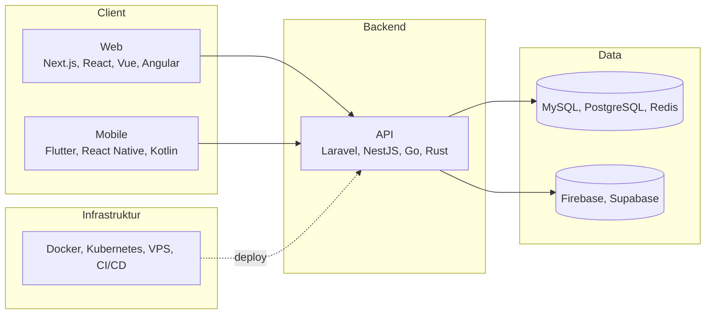
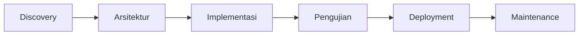

 

---

## 👨‍💻 Tentang Saya

Saya adalah **software engineer** yang menangani seluruh siklus pengembangan: analisis kebutuhan, perancangan arsitektur, backend, frontend, aplikasi mobile lintas platform, sampai deployment dan operasional server. Berawal dari ekosistem PHP & Laravel, kini saya bekerja lintas bahasa dan framework, dan memilih teknologi berdasarkan **kebutuhan masalah, bukan tren**.

Saya mengelola infrastruktur sendiri, dari provisioning VPS, containerization, sampai orkestrasi Kubernetes, sehingga setiap keputusan di level kode mempertimbangkan bagaimana sistem akan di-deploy, dipantau, dan dirawat.

|  |  |
| --- | --- |
| 🔭 **Saat ini** | Membangun dan mengembangkan **[Flux Project](https://fluxproject.pages.dev)** |
| 🧰 **Spesialisasi** | Backend, Web, Mobile (Android & iOS), DevOps |
| 🤖 **Workflow** | Pengembangan dibantu AI agent (Claude Code, Antigravity, Codex, Hermes) |
| 📫 **Terbuka untuk** | Proyek freelance, kolaborasi, dan kerja sama bisnis |

---

## 🧭 Prinsip Engineering

- **Right tool for the job:** teknologi dipilih lewat pertimbangan trade-off (performa, skalabilitas, biaya, kemudahan perawatan)
- **Arsitektur yang bersih:** pemisahan tanggung jawab yang jelas, kode mudah dibaca, diuji, dan dikembangkan
- **Security by default:** validasi input, autentikasi dan otorisasi yang benar, pengelolaan secret yang aman
- **Reproducible environment:** development, staging, dan production konsisten lewat Docker dan CI/CD
- **AI sebagai akselerator:** AI agent mempercepat iterasi, sementara keputusan arsitektur, review, dan pengujian tetap di tangan engineer

---

## 🚀 Flux Project

**[Flux Project](https://fluxproject.pages.dev)** adalah startup yang saya dirikan untuk menyediakan jasa pengembangan IT profesional bagi individu, bisnis, dan institusi.

| Layanan | Cakupan |
| --- | --- |
| 🌐 **Pengembangan Web** | Company profile, landing page, aplikasi web, dashboard, REST API |
| 📱 **Aplikasi Mobile** | Android & iOS dengan Flutter, React Native, dan Kotlin |
| 🧩 **Sistem Informasi** | Perancangan dan pembangunan sistem sesuai kebutuhan bisnis |
| ☁️ **Deployment & DevOps** | Setup VPS, containerization, orkestrasi, CI/CD |

---

## 🛠️ Tech Stack

**Backend & Full-Stack** 

**Frontend** 

**Mobile (Android & iOS)** 

**Database & Backend-as-a-Service** 

**DevOps & Infrastruktur** 

**Tools & Version Control** 

---

## 🏗️ Dari Ide ke Production

Satu ekosistem utuh yang saya kerjakan sendiri, dari client sampai infrastruktur:

---

## ☁️ Infrastruktur & Self-Hosting

Saya terbiasa mengelola server secara mandiri lewat akses remote ke VPS:

- Provisioning dan konfigurasi server Linux melalui SSH
- Deployment dengan Docker dan, untuk skala lebih besar, orkestrasi Kubernetes
- Konfigurasi web server dan reverse proxy
- Pipeline CI/CD dengan GitLab dan GitHub Actions
- Maintenance, monitoring, dan troubleshooting layanan di production

---

## 🤖 AI-Assisted Development

| Tool | Peran dalam workflow |
| --- | --- |
| **Claude Code** | Implementasi fitur, refactoring, dan review kode dari terminal |
| **Antigravity (agy)** | Pengembangan agentic dan eksplorasi solusi |
| **Codex** | Generasi dan penyempurnaan kode |
| **Hermes** | Otomasi tugas dan dukungan alur kerja developer |

---

## 🔄 Alur Kerja Proyek

1. **Discovery:** memahami tujuan bisnis, kebutuhan pengguna, dan batasan teknis
2. **Arsitektur:** menentukan stack, desain sistem, dan skema data
3. **Implementasi:** pengembangan bertahap dengan version control dan code review
4. **Pengujian:** validasi fungsi, keamanan, dan performa sebelum rilis
5. **Deployment:** rilis ke production dengan pipeline terotomasi
6. **Maintenance:** pemantauan dan pengembangan berkelanjutan

---

## 📊 GitHub Stats

---

## 🐍 Contribution Snake

<picture>
  <source media="(prefers-color-scheme: dark)" srcset="https://raw.githubusercontent.com/Fathnix/Fathnix/output/github-snake-dark.svg">
  <source media="(prefers-color-scheme: light)" srcset="https://raw.githubusercontent.com/Fathnix/Fathnix/output/github-snake.svg">
  
</picture>

---

## 🤝 Mari Bekerja Sama

Tertarik membangun produk digital bersama atau butuh bantuan teknis untuk proyek Anda?

- 🌐 **Website:** [fluxproject.pages.dev](https://fluxproject.pages.dev)
- 💼 **LinkedIn:** [Muhammad Fatih](https://linkedin.com/in/muhammad-fatih-ganteng2109)
- 📧 **Email:** [mhmd.fatih2106@gmail.com](mailto:mhmd.fatih2106@gmail.com)

⭐️ *Terima kasih sudah mampir ke profil saya!* ⭐️

